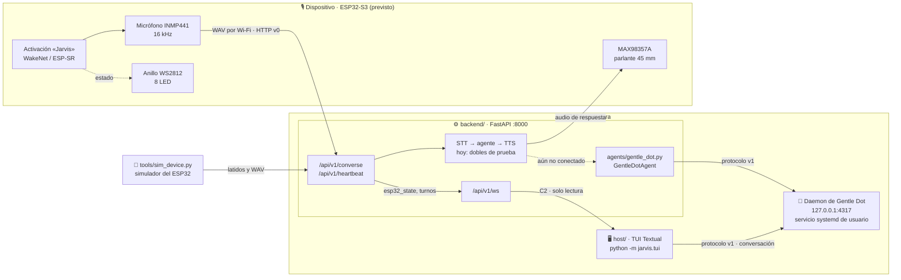

<div align="center">

# 🤖 J.A.R.V.I.S. de Escritorio

**Asistente de voz de escritorio: un ESP32-S3 escucha «Jarvis», la PC piensa y actúa, y una TUI muestra todo.**

[](https://github.com/Jaimewww/jarvis-esp32/actions/workflows/ci.yml)


[Arquitectura](#-arquitectura) · [Estado](#-estado-por-pista) · [Arranque rápido](#-arranque-rápido) · [Cómo trabajamos](#-cómo-trabajamos) · [Documentación](#-documentación)

</div>

---

Diseño actualizado con el informe del **11 de noviembre de 2026**: el ESP32-S3 detecta
«Jarvis», captura y reproduce audio; la computadora coordina transcripción, agente,
síntesis de voz y acciones sobre la propia PC. El anillo WS2812 muestra el estado.

> [!NOTE]
> Hay software en `backend/`, `host/` y `tools/`, y nada de hardware: no hay firmware ni
> modelos CAD. Las capacidades de abajo son objetivos, no funciones verificadas en
> hardware. No hay mediciones de latencia del sistema.

## 🧭 Arquitectura



**Flujo:** voz → activación local → captura → Wi-Fi → backend en la PC (STT → agente → TTS)
→ audio al ESP32 → altavoz. Las acciones se ejecutan en la PC y se registran en la TUI.
Las fronteras entre piezas son los [contratos](docs/contratos.md) (C1-C4).

**Fuera de alcance:** domótica u otros periféricos, funcionamiento sin computadora
encendida y conectada a la misma red, batería, identificación del hablante y uso
multiusuario simultáneo. La alimentación es por USB.

## 📦 Qué hay en el repo

| | Carpeta | Contenido | Estado |
|---|---|---|---|
| ⚙️ | [`backend/`](backend/README.md) | Orquestador en la PC: contrato de transporte v0 (latido, conversación y WebSocket), puertos `Transcriber`/`Agent`/`Synthesizer` con dobles, y el adaptador de Gentle Dot | STT, agente y TTS todavía devuelven respuestas de prueba |
| 🖥️ | [`host/`](host/README.md) | TUI cliente del daemon de Gentle Dot y del WebSocket del backend (vista usuario y vista desarrollador, modo oscuro y claro), y la unidad systemd del daemon | Funciona contra el daemon y el backend |
| 🧪 | [`tools/`](tools/sim_device.py) | `sim_device.py`: un turno completo como el ESP32, sin placa | Sin pruebas automáticas |
| 🔌 | `firmware/` | Proyecto ESP-IDF del ESP32-S3 (Fase 1) | Previsto, aún no existe |
| 🧊 | `cad/` | Modelos de la caja (Fase 7) | Previsto, aún no existe |
| 📚 | [`docs/`](docs/decisiones.md) | Diseño, decisiones, contratos, tareas y planificación | Ver [documentación](#-documentación) |
| 📝 | [`odd/tasks/`](odd/tasks/s2-track.md) | Documentos de seguimiento de cada tarea: specs, tareas y registro con evidencia | Al día por pista |

## 🚦 Estado por pista

Según el reparto de [D21](docs/decisiones.md#d21--reparto-del-trabajo) y las
[tareas por pista](docs/tareas.md). ✅ hecho · 🟡 en curso · ⏳ pendiente.

<table>
<tr><th>🗣️ S1 · Voz</th><th>🧠 S2 · Agente y pantalla</th><th>🔌 Dispositivo</th></tr>
<tr valign="top">
<td>

| # | Tarea | |
|---|---|---|
| — | Contratos y dobles (#1) | ✅ |
| V1 | STT real en `/converse` | ⏳ |
| V2 | TTS real | ⏳ |
| V3 | Camino rápido y catálogo | ⏳ |
| V4 | Motor de la charla de voz | ⏳ |
| V5 | `turn_error`, `turn_stage`, `409` | ⏳ |

</td>
<td>

| # | Tarea | |
|---|---|---|
| P1 | TUI conectada al backend | ✅ |
| P2 | Presentación de la TUI (#6) | ✅ |
| P3 | Daemon como servicio (#5) | ✅ |
| P4 | Adaptador de tareas largas (#4, #7) | ✅ |
| — | CI con GitHub Actions (#3) | ✅ |
| — | Instalador de systemd endurecido (#9) | ✅ |
| — | `/login` en la TUI, agilidad de respuesta | ⏳ |

</td>
<td>

| Tarea | |
|---|---|
| Responsable | ⏳ por asignar cuando llegue la placa |
| `firmware/` | ⏳ no existe |
| WakeNet y «Jarvis» en la placa | ⏳ |

</td>
</tr>
</table>

Fuentes: [`docs/tareas.md`](docs/tareas.md), [`odd/tasks/s2-track.md`](odd/tasks/s2-track.md),
[`odd/tasks/s2-round2.md`](odd/tasks/s2-round2.md) y las fusiones de `main`. El adaptador
de Gentle Dot está probado contra un daemon falso y contra el real, pero todavía no está
conectado al turno de `/converse`.

## 🎯 Decisiones de diseño

El diseño es del informe del 2026-11-11; las decisiones de arquitectura del 2026-11-18
están en [decisiones](docs/decisiones.md) y prevalecen donde difieran.

| Tema | Diseño vigente |
|---|---|
| 🎙️ Activación | «Jarvis» en el ESP32-S3 con WakeNet/ESP-SR; pulsador solo como respaldo. Compatibilidad e integración por validar. |
| 🔌 Firmware | ESP-IDF. |
| 📡 Captura | Orden a 16 kHz, detección de fin del habla en el ESP32 y envío por Wi-Fi con el contrato HTTP v0. |
| 🗣️ Transcripción y voz | STT y TTS locales en la PC. Modelo por elegir: Whisper frente a Parakeet para STT, Piper como primer candidato de TTS. |
| 🧠 Agente | Daemon de Gentle Dot como dependencia externa, detrás de un adaptador del backend. |
| ⚡ Acciones | Catálogo de acciones de bajo riesgo sin confirmación y por camino rápido; lo demás va al agente. |
| 💡 Estado | Reposo, escuchando, pensando, hablando y error en anillo y TUI. |
| 🧩 Hardware | ESP32-S3 N16R8, INMP441, MAX98357A, parlante de 45 mm y anillo de 8 LED. |
| 💵 Presupuesto | USD 50,64 obligatorios + 13,94 opcionales = 64,58; sin envío ni filamento, con salvedades de IVA. |

El diseño anterior de nube como centro obligatorio, PTT primario y proveedores fijos
quedó sustituido.

## 🚀 Arranque rápido

Sin placa: backend + simulador para la voz, daemon de Gentle Dot + TUI para el agente.
Los comandos salen de [`backend/README.md`](backend/README.md) y
[`host/README.md`](host/README.md), donde están todos los detalles.

<details>
<summary>⚙️ <b>Backend</b> — orquestador en <code>:8000</code></summary>

```bash
cd backend
python -m venv .venv
. .venv/bin/activate
pip install -r requirements.txt
uvicorn app.main:app --port 8000
```

Tokens por defecto (solo para desarrollo, redefinir con variables de entorno):
`JARVIS_DEVICE_TOKEN=dev-jarvis-token`, `JARVIS_HOST_TOKEN=dev-host-token`.

Pruebas:

```bash
cd backend
.venv/bin/pip install -r requirements-dev.txt
.venv/bin/python -m pytest tests -q
```

</details>

<details>
<summary>🧪 <b>Simulador del dispositivo</b> — <code>tools/sim_device.py</code></summary>

Hace un turno completo como el ESP32 (latidos, WAV a `/converse`, descarga del audio).
Con el backend corriendo, desde la raíz del repositorio:

```bash
python tools/sim_device.py --url http://127.0.0.1:8000 --token dev-jarvis-token
```

Ver [dobles para avanzar sin la otra parte](docs/contratos.md#dobles-para-avanzar-sin-la-otra-parte).

</details>

<details>
<summary>🖥️ <b>TUI del host</b> — <code>python -m jarvis.tui</code></summary>

Requiere Python 3.11 o superior y un daemon de Gentle Dot corriendo (ver el siguiente
apartado). La TUI no arranca ni reemplaza al daemon.

```bash
cd host
python -m venv .venv
. .venv/bin/activate
pip install -r requirements.txt
python -m jarvis.tui                          # ws://127.0.0.1:4317/ws, ~/.gentle-dot/token
python -m jarvis.tui --backend-url ws://192.168.1.10:8000/api/v1/ws
python -m jarvis.tui --theme paper            # otro tema
```

Teclas: **Enter** envía, **Ctrl+A** detiene la respuesta, **Ctrl+Q** sale, **F2** alterna
vista usuario y vista desarrollador, **F3** alterna modo oscuro y claro.

Pruebas:

```bash
cd host
pip install -r requirements-dev.txt
python -m pytest tests -q
```

</details>

<details>
<summary>🧠 <b>Daemon de Gentle Dot como servicio</b> — <code>host/systemd/install.sh</code></summary>

Según [D1](docs/decisiones.md#d1--gentle-dot-es-una-dependencia-externa), Jarvis usa el
daemon original de Gentle Dot, sin modificar y fijado a una versión, como servicio de
usuario de systemd. Requisitos (systemd 254+, Node 24+ con la ruta del binario real y
el checkout en el commit fijado) en
[host/README.md](host/README.md#daemon-de-gentle-dot-como-servicio).

```bash
git clone https://github.com/Gentleman-Programming/gentle-dot
cd gentle-dot
git switch --detach f97d56d884b1d3c178f415b95d486464e7b220bf
pnpm install --frozen-lockfile
```

Desde la raíz de este repositorio, primero sin cambiar nada y después de verdad:

```bash
host/systemd/install.sh --gentle-dot-dir ~/ruta/gentle-dot \
  --node "$(mise where node@24)/bin/node" --check     # solo verifica requisitos
host/systemd/install.sh --gentle-dot-dir ~/ruta/gentle-dot \
  --node "$(mise where node@24)/bin/node" --dry-run   # muestra la unidad y los comandos
host/systemd/install.sh --gentle-dot-dir ~/ruta/gentle-dot \
  --node "$(mise where node@24)/bin/node" --enable
```

Verificar:

```bash
systemctl --user status gentle-dot.service
journalctl --user -u gentle-dot.service -f
ls -l ~/.gentle-dot/token          # lo crea el daemon, modo 0600
```

Pruebas del instalador, sin systemd ni Gentle Dot: `bash host/systemd/test_install.sh`.

</details>

## ✅ Integración continua

[`.github/workflows/ci.yml`](.github/workflows/ci.yml) corre en cada push a `main` y en
cada solicitud de fusión, con Python 3.14 (la versión de `backend/.venv` que fija
`pyrightconfig.json`):

| Paso | Qué corre |
|---|---|
| `backend · pytest` | Las pruebas de `backend/tests` |
| `pyright` | El chequeo de tipos de `pyrightconfig.json` sobre `backend/app` |
| `host · pytest` | Las pruebas de `host/tests` |
| `host · systemd unit` | `host/systemd/test_install.sh`: el servicio del daemon y su instalador contra un directorio temporal, sin instalar nada |

`tools/` aún no tiene pruebas automáticas, así que no hay paso para él. Para correr lo
mismo en local:

```bash
cd backend
python3.14 -m venv .venv
.venv/bin/pip install -r requirements-dev.txt
.venv/bin/python -m pytest tests -q

# pyright, desde la raíz; resuelve los imports con backend/.venv
.venv/bin/pip install pyright==1.1.414
cd ..
backend/.venv/bin/pyright
```

El servicio del daemon tiene pruebas propias, las mismas del paso `host · systemd unit`:
`bash host/systemd/test_install.sh` (ver
[host/README.md](host/README.md#daemon-de-gentle-dot-como-servicio)).

## 🔭 Qué sigue

- 🎯 Primer hito: un turno completo desde la PC, con STT, agente y TTS reales y tiempos
  por etapa, sin esperar al hardware.
- 🎙️ Validar WakeNet y el modelo de «Jarvis» en la placa, con voces del equipo y ruido de aula.
- ❓ Cerrar las [decisiones abiertas](docs/decisiones.md#decisiones-abiertas): PC de la
  demostración, modelos, catálogo de acciones, autenticación y pruebas.

## 🤝 Cómo trabajamos

- 🛣️ Cada pista toca solo sus carpetas; las fronteras son los [contratos](docs/contratos.md).
  El reparto y el orden de las tareas están en [tareas](docs/tareas.md), y el porqué en
  [decisiones](docs/decisiones.md).
- 🔒 `README.md`, `docs/decisiones.md` y `docs/contratos.md` son compartidos: se cambian
  en una solicitud propia, sin mezclar con código, y la aprueba la otra pista.
  [`.github/CODEOWNERS`](.github/CODEOWNERS) pide la revisión al responsable.
- 📝 Cada tarea tiene su documento de seguimiento en [`odd/tasks/`](odd/tasks/s2-track.md)
  (specs, tareas y registro con evidencia).
- 📋 Cada fase del [plan](docs/planificacion.md) tiene criterios de aceptación previstos.
- 🔄 Los cambios de alcance se documentan; esta documentación describe el diseño vigente.
- ✍️ Commits con Conventional Commits.
- 🌐 Sitio Quarto sobre cómo trabajamos, en `docs/sitio/`: en preparación.

## 📚 Documentación

| | Documento | Contenido |
|---|---|---|
| 🎯 | [Decisiones](docs/decisiones.md) | Decisiones de arquitectura del 2026-11-18 y su porqué |
| 🔗 | [Contratos](docs/contratos.md) | Fronteras entre firmware, backend y host, y dobles para probar |
| 🧭 | [Arquitectura](docs/arquitectura.md) | Responsabilidades, flujo y alcance |
| 🧾 | [Materiales](docs/materiales.md) | BOM consultada el 2026-11-11 y conexiones propuestas |
| 🗓️ | [Planificación](docs/planificacion.md) | Fases y cinco roles funcionales |
| 🛣️ | [Tareas](docs/tareas.md) | Tareas de cada pista, en orden, y reglas para no pisarse |
| 🔌 | [Firmware](docs/firmware.md) | Activación local, audio, red y decisiones pendientes |
| 🗣️ | [Backend e IA](docs/nube.md) | Comparación STT, Gentle Shell y alternativas |
| 🖥️ | [Host y TUI](docs/tui.md) | Conversación, estado y registro de acciones |
| 🧊 | [Caja 3D](docs/caja-3d.md) | Diseño mecánico previsto |
| 🧪 | [Pruebas](docs/pruebas.md) | Validación futura y riesgos |
| ⚙️ | [backend/README.md](backend/README.md) | Endpoints, adaptador de Gentle Dot, pruebas y lo que falta |
| 🖥️ | [host/README.md](host/README.md) | TUI, servicio del daemon, teclas, temas y pruebas |
